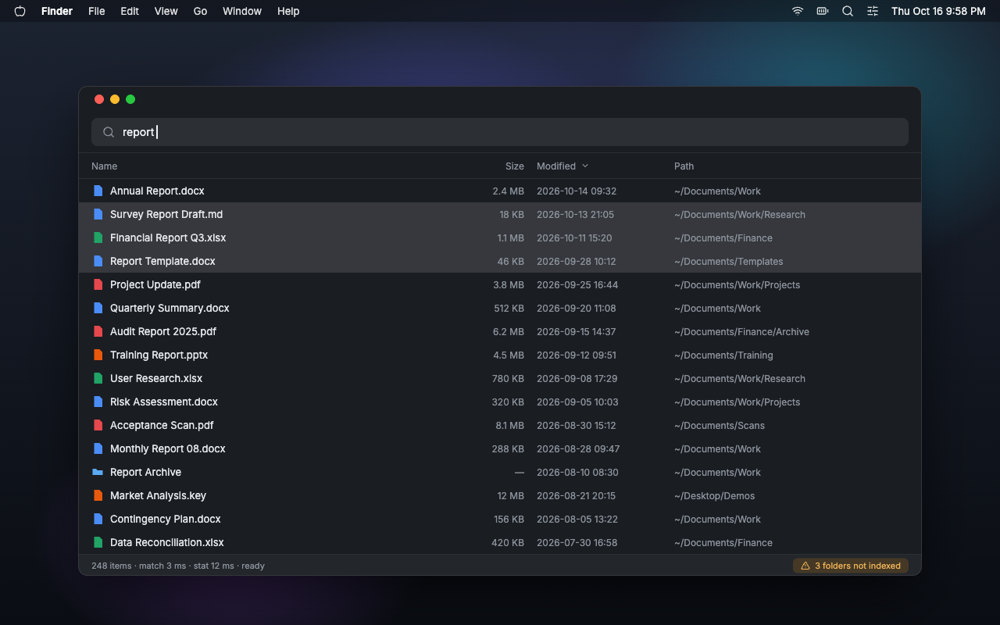

# macEverything

<p align="center">
  
</p>

[](https://github.com/modouai/macEverything/releases/latest)
[](https://github.com/modouai/macEverything/actions/workflows/ci.yml)
[](LICENSE)
[](#requirements)
[](https://www.rust-lang.org/)

English | [简体中文](README.zh-CN.md)

**Instant filename search for macOS. Everything, for the Mac.**

macEverything builds and maintains its own index instead of relying on Spotlight. Folders that Spotlight silently skips (privacy exclusions, `.noindex` trees, disabled indexing) can be indexed here — unless you exclude them — and permission gaps are always listed explicitly.

Coverage: your home directory, `/Applications` and local external volumes (network volumes are not indexed yet).

- **Million files in ~1 s**: first scan takes 1.0-1.6 s; every later launch opens instantly from the on-disk index
- **P99 query < 4 ms**: substring/wildcard search across 1.2M+ entries
- **Live updates**: changes become searchable in ≤ 0.3 s; 0% idle CPU
- **Complete**: the entry set matches `find` exactly
- **Floating bar (⌥Space)**: appears over full-screen apps, type-to-search, keyboard-driven
- **Results window (⌥⇧F)**: sortable table, multi-select, native context menus, Quick Look
- **Directory Assist (experimental)**: when another app opens a save or open dialog, a folder search field appears next to it — ↵ jumps the dialog there (off by default; needs the Device Control and Data Access permission)
- **Bilingual UI**: English / 简体中文, follows the system by default

## Why not Spotlight?

Spotlight is a great launcher, but its index is managed by macOS and silently excludes directories: TCC-protected folders, `.noindex` trees, parts of your home directory. You never learn *what* is missing.

How macEverything differs:

| | Spotlight | macEverything |
|---|---|---|
| What gets indexed | Decided by macOS | Your home folder + `/Applications` |
| Folders excluded from Spotlight | Never indexed | Indexed unless you exclude them |
| Folders it can't read | Not shown | Listed by name and reason |
| Development folders | Sometimes skipped | Searchable; `node_modules` and `.git` excluded by default |
| Index management | Managed by macOS | Managed by the app |
| Terminal | `mdfind` | `macEverything` (five subcommands, `--json`) |

If a directory can't be read (e.g. Full Disk Access not granted yet), it is listed by name and reason in `status`, the tray menu and the results window — the gap is never silent. Filename search is Everything-style substring/wildcard matching with quality ranking, not fuzzy metadata search.

Default excludes: `~/Library`, `node_modules`, `.git`, `~/.Trash` and per-volume metadata folders. Change them in Settings → Index or with `macEverything exclude`.

<p align="center">
  
</p>

## Performance

Apple M5 + NVMe, 1.23M entries.

Engine:

| Metric | Measured | Notes |
|---|---|---|
| First scan | **1.0-1.6 s** per million files | Parallel traversal; every later launch is instant (mmap of the on-disk index) |
| Query | **P99 2.9-3.6 ms** | substring/wildcard over the whole index |
| Incremental update | **≤ 0.3 s** to searchable | Live FSEvents; 0% idle CPU |
| Completeness | **zero diff** vs `find` | Same scan roots and excludes; parity test enforces it |
| Downtime catch-up | seconds | On restart, events from the downtime are replayed, not a full rescan |

GUI (release build):

| Metric | Measured | Notes |
|---|---|---|
| Floating bar summon | median **95 ms** | ⌥Space press → visible (system hotkey delivery ≈ 51 ms of it) |
| Keystroke → results | median **~67 ms** | Per character, as you type |
| Resident memory | **~136 MB** | eframe/egui + OpenGL baseline, independent of window usage |
| Hidden-state CPU | **0%** | both windows hidden |
| New file → searchable in the UI | **267 ms** | End to end |

## Installation

### Download (recommended)

Grab the latest DMG (Developer ID signed and notarized) from the website and drag the app into `Applications`:

**[maceverything.modouai.dev](https://maceverything.modouai.dev/)**

### Build from source

Requirements: macOS 13+ on Apple Silicon (Intel Macs are not supported; the released DMG is arm64-only) plus a stable Rust toolchain.

```bash
git clone https://github.com/modouai/macEverything.git
cd macEverything

# GUI app: build + assemble .app + ad-hoc signing → release/macEverything.app
bash scripts/bundle.sh
open release/macEverything.app

# CLI only (symlink into any directory on your PATH):
cargo build --release
ln -sf "$PWD/target/release/macEverything" ~/.cargo/bin/macEverything
```

## Getting started

After launch the app lives in the menu bar (no Dock icon and no window; that is normal):

| Action | How |
|---|---|
| Floating search bar | **⌥Space**: type to search, ↑↓ to select, ↵ open, ⌘↵ reveal in Finder, ⌥↵ continue in the full window, Esc hide |
| Full results window | **⌥⇧F**: four columns (name / size / modified / path), click headers to sort, multi-select, Space for Quick Look |
| Directory Assist | Folder search field next to save/open dialogs; enable under Settings → Experimental → Directory Assist (off by default) |
| Menu bar icon | Left-click toggles the floating bar; right-click for engine status, gaps, open search / open full window, autostart, settings, update check and quit |

Both shortcuts can be re-recorded in Settings → General → Shortcuts. If a shortcut is taken by another app, the app falls back to ⌥⇧Space / ⌃⌥⇧Space and says so in the floating bar.

CLI:

```bash
macEverything start              # launch the engine in the background
macEverything query "report"     # results as you type
macEverything query "*.pdf path:Documents 2026"
macEverything query --sort mtime --desc "invoice"   # newest first
macEverything status             # index state + permission gaps
macEverything exclude add ~/Videos
macEverything exclude list       # add | remove | list | reset
macEverything stop
```

When the engine is offline, `query` falls back to reading the on-disk index directly and labels the results `offline index · generated at …`.

`query` and `status` accept `--json` for schema-versioned machine-readable output, so scripts and AI/agent tools can call the CLI directly; the flags and the JSON contract are in the [usage guide](docs/usage.md). The bundled app can also install the CLI onto your `PATH` from Settings → General → Command-Line Tool.

## Search syntax

| Syntax | Meaning | Example |
|---|---|---|
| keyword | filename substring; space-separated = AND | `quarter report` |
| `*` | wildcard, any length (including empty) | `*.pdf`, `report*` |
| `?` | wildcard, single character | `report?` |
| `path:` | the next word matches the full path | `path:Documents invoice` |
| `case:` | case-sensitive for this query | `case:README` |
| `whole:` | whole-word match for this query | `whole:init` |

<details>
<summary><b>Full syntax rules and ranking</b></summary>

- Case folding covers the whole of Unicode: `café` finds `CAFÉ`, and NFC/NFD spellings match each other.
- `path:` applies to the single word that follows it; the remaining words still match the filename.
- Prefixes must be lowercase; `*` and `?` are always wildcards (there is no escaping).
- Whole-word boundaries: `_` counts as a word character — `whole:init` matches `init.rs` but not `__init__.py`.
- Ranking: `.app` bundles are pinned to the top (except `.app`s nested inside another bundle); within a group, filename prefix > word-boundary > substring, shorter names winning ties. Sorting by column headers is unaffected.
- Combination examples: `path:项目 *.md`, `path:Documents 发票 2026`.
- Not supported yet: regex, `size:` and date filters (on the v2 candidate list).

Full rules: [usage guide](docs/usage.md) (Chinese).

</details>

## How it works

An FSEvents event is only a hint that something changed. The daemon re-reads that directory and diffs it against the index, so the disk is always authoritative. FSEvents' coarse semantics (dropped events, coalescing, one-sided renames) therefore cannot make the index diverge from disk.

```
┌────────────────────────────────────────────┐
│ app · eframe/egui                          │
│ floating bar · results window · tray       │
│ hotkeys · autostart · update check         │
└──────────────────┬─────────────────────────┘
                   │ Unix socket · length-prefixed JSON
                   │ crates/protocol + crates/client
┌──────────────────▼─────────────────────────┐
│ cli · macEverything start (daemon)         │
│ ┌────────────────────────────────────────┐ │
│ │ engine · pure logic library            │ │
│ │ scan → index → query                   │ │
│ │ FSEvents → diff → index                │ │
│ │ mmap persistence (layout mirror)       │ │
│ └────────────────────────────────────────┘ │
└────────────────────────────────────────────┘
```

| Crate | Responsibility |
|---|---|
| `engine` | All business logic: scan, index, query, mmap persistence, FSEvents + diff |
| `protocol` | Wire contract: messages, codec, validation, version |
| `client` | Connection, on-demand `stat`, offline fallback, status constants |
| `cli` | Daemon host + `start/stop/query/status/exclude` with `--json` |
| `app` | GUI: floating bar, results window, tray, hotkeys, autostart, update check, Directory Assist |

## For developers

### Core engine

| Area | Design |
|---|---|
| Index layout | Flat `Entry` array (24 B per entry) + two name pools + a directory path pool; deletes are tombstones |
| Query | Each query compiles to anchored substring sequences; every needle becomes a precompiled `memchr` Finder — P99 3.6 ms over 1.2 M entries |
| Scan | Work-sharing parallel traversal; the same exclusion predicate is used by first scan, incremental updates and link repair |
| Persistence | The file mirrors the in-memory layout; loading is `mmap` + cast, no deserialization; atomic tmp + rename |
| FSEvents | Events are hints only — re-read the directory, diff against the index, the disk wins |
| Downtime | `last_event_id` is persisted; restart replays events since then (seconds), with a conservative full-rescan fallback |

### Testing

Three layers; unit and parity run under `cargo test --workspace`, the live layer is `#[ignore]`:

| Layer | Where | What it proves |
|---|---|---|
| Unit | `#[cfg(test)]` per module | Parsing, matching, index ops, persistence and diff logic; controlled `tempfile` trees |
| Parity | `crates/engine/tests/parity.rs` | Index entry set vs an independent recursive enumeration — zero diff; serial and parallel paths agree |
| Live | `crates/engine/tests/fsevents_live.rs` | Real FSEvents streams and downtime replay; `#[ignore]`, run manually on a Mac |

New tests are mutation-checked: break the implementation on purpose and confirm the test fails. See [CONTRIBUTING.md](CONTRIBUTING.md).

### Repository layout

```
crates/
├── engine/    scan · index · query · mmap persistence · FSEvents + diff
├── protocol/  wire contract (messages, codec, validation, version)
├── client/    connection · on-demand stat · offline fallback
├── cli/       daemon + start/stop/query/status/exclude (+ --json)
└── app/       eframe/egui UI · tray · hotkeys · autostart · update check
docs/          architecture · usage · development · specs
scripts/       bundle · release · bench · parity-check · memory watch
```

## Known limitations

- Scan scope: home directory + `/Applications` + local external volumes (indexed automatically on mount, dropped on eject, per-volume toggle in settings). Network volumes (SMB/NFS) are not indexed yet.
- Default excludes: `~/Library`, `node_modules`, `.git`, `~/.Trash` and per-volume metadata folders (`.fseventsd`, `.Trashes`, `.Spotlight-V100`, `.DocumentRevisions-V100`). Change them with `macEverything exclude` or in Settings → Index.
- `case:` applies to the filename side only (path matching is always case-insensitive).
- No regex, `size:` or date filters yet (on the v2 candidate list).
- The GUI process idles at ~136 MB, the baseline of the eframe/egui + OpenGL stack, independent of window usage. Above the <100 MB design target; details in the [architecture overview](docs/architecture.md) (Chinese).
- When the floating bar is fully covered by another window, keystroke→results degrades to ~500 ms (occluded viewports skip render frames; a visible floating bar is unaffected).
- With the engine offline, column sorting in the results window is unavailable; the status bar says so and offers a "Restart engine" button.
- Directory Assist is experimental and off by default; it needs the Device Control and Data Access permission and cannot navigate apps that draw their own save/open panels (some web and Electron apps).

## Documentation

| Doc | Contents |
|---|---|
| [Usage guide](docs/usage.md) | GUI and all five CLI commands, syntax rules, permissions, data directory, troubleshooting (Chinese) |
| [Architecture](docs/architecture.md) | Engine design, core decisions and ADR-7/8, lifecycle, benchmarks (Chinese) |
| [Development](docs/development.md) | Build, test, bench, conventions and pitfalls (Chinese) |
| [Specs](docs/specs/) | Product, technical and implementation specs per feature (Chinese) |
| [Website guides](https://maceverything.modouai.dev/) | Everything for Mac, Spotlight troubleshooting, and a Mac file-search guide |

## Contributing

Issues and pull requests are welcome!

Before declaring a change done, three checks must pass:

```bash
cargo fmt --check
cargo clippy --workspace --all-targets -- -D warnings
cargo test --workspace
```

See the [development guide](docs/development.md) (Chinese) for the full workflow. FSEvents integration tests are marked `#[ignore]` and need a real Mac: `cargo test -p engine --test fsevents_live -- --ignored`.

See [CONTRIBUTING.md](CONTRIBUTING.md) for conventions, [SECURITY.md](SECURITY.md) for vulnerability reports and [PRIVACY.md](PRIVACY.md) for data handling. Third-party licenses are listed in [THIRD-PARTY-NOTICES.md](THIRD-PARTY-NOTICES.md).

## Requirements

macOS 13 or later on Apple Silicon (Intel Macs are not supported; the released DMG is arm64-only). Rust stable for building from source. Data directory: `~/Library/Application Support/macEverything/`. Full Disk Access is optional; without it, unreadable directories are listed explicitly and everything else works. The on-disk index uses about 63 MB per 1 million files. The optional Directory Assist uses the separate Device Control and Data Access permission.

## License

[MIT](LICENSE) © modouai
