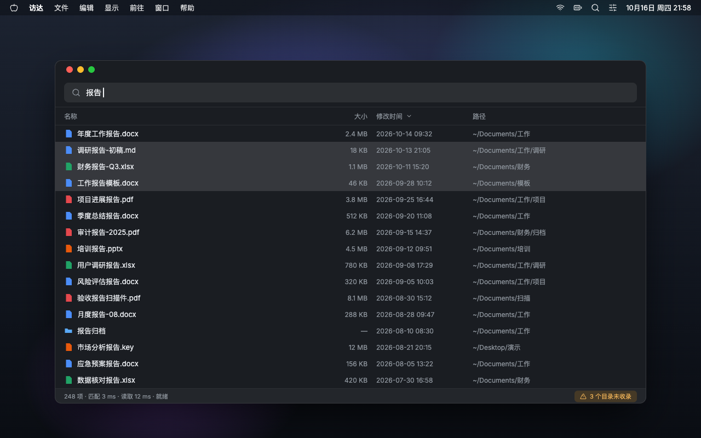

# macEverything

<p align="center">
  
</p>

[](https://maceverything.modouai.dev/)
[](LICENSE)
[](#环境要求)
[](https://www.rust-lang.org/)

[English](README.md) | 简体中文

**macOS 文件名即时搜索——Windows [Everything](https://www.voidtools.com/zh-cn/support/everything/) 的 Mac 版。**

macEverything 自建索引、不走 Spotlight:Spotlight 静默搜不到的目录(隐私排除、`.noindex`、开发目录),这里全都能搜到;权限缺口永远显式列出。

覆盖范围:用户主目录、`/Applications` 与本地外接磁盘(网络盘暂不索引)。

- **百万文件约 1 秒建好索引**:首扫 1M 文件 1.0-1.6 s,之后每次启动秒开(读落盘索引)
- **查询 P99 < 4 ms**:123 万+ 条目上的子串/通配搜索
- **实时增量**:文件系统变更 ≤ 0.3 s 可搜,空闲 CPU 0%
- **完整**:与 `find` 零差异
- **悬浮条(⌥Space)**:跨全屏应用上方可唤起,输入即搜,键盘全操作
- **完整结果窗口(⌥⇧F)**:可排序、多选、原生右键菜单、Quick Look
- **双语界面**:简体中文 / English,默认跟随系统

## 为什么不走 Spotlight?

Spotlight 是出色的启动器,但它的索引由 macOS 管理,并且静默排除目录:TCC 保护目录、`.noindex`、主目录的某些部分。你永远不知道漏了什么。

macEverything 的做法:

- **自建索引**:并行遍历文件系统直接建索引。
- **缺口显式**:目录读不了(比如尚未授予完全磁盘访问权限)时,`status`、托盘菜单、结果窗口都会逐目录列出名字与原因。
- **Everything 式文件名搜索**:子串/通配匹配 + 质量排序,而非模糊的元数据搜索。

<p align="center">
  
</p>

## 性能(Apple M5 + NVMe,约 123 万条目)

引擎口径:

| 指标 | 实测 | 说明 |
|---|---|---|
| 首扫 | 百万文件 **1.0-1.6 s** | 并行遍历;之后每次启动秒开(读落盘索引) |
| 查询 | **P99 2.9-3.6 ms** | 全索引子串/通配匹配 |
| 增量 | **≤ 0.3 s** 可搜 | FSEvents 实时;空闲 CPU 0% |
| 完整性 | 与 `find` **零差异** | `find` 能看到的全能搜到 |
| 停机补齐 | 秒级 | 重启重放关机期间事件,非全量重扫 |

图形界面口径(release 构建):

| 指标 | 实测 | 说明 |
|---|---|---|
| 悬浮条唤起 | 中位 **95 ms** | ⌥Space 按下到可见(其中系统热键投递约 51 ms) |
| 输入到结果 | 中位 **~67 ms** | 逐字符,边输边出 |
| 常驻内存 | **~136 MB** | eframe/egui + OpenGL 技术栈基线,与窗口使用无关 |
| 隐藏态 CPU | **0%** | 两窗皆隐 |
| 新文件 → 界面可搜 | **267 ms** | 端到端 |

## 安装

### 下载(推荐)

官网下载 DMG(Developer ID 签名并通过公证),拖入「应用程序」即可:

**[maceverything.modouai.dev](https://maceverything.modouai.dev/)**

### 源码构建

环境要求:macOS 13+(Apple Silicon,不支持 Intel,发布的 DMG 仅含 arm64)、Rust stable。

```bash
git clone https://github.com/modouai/macEverything.git
cd macEverything

# 图形界面:构建 + 组装 .app + ad-hoc 签名 → release/macEverything.app
bash scripts/bundle.sh
open release/macEverything.app

# 仅命令行(软链进 PATH 中的任意目录):
cargo build --release
ln -sf "$PWD/target/release/macEverything" ~/.cargo/bin/macEverything
```

## 快速开始

启动后 App 常驻菜单栏(无窗口、无 Dock 图标,这是正常形态):

| 操作 | 方式 |
|---|---|
| 悬浮搜索条 | **⌥Space**:输入即搜,↑↓ 选择,↵ 打开,⌘↵ 访达显示,⌥↵ 带词进完整窗口,Esc 隐藏 |
| 完整结果窗口 | **⌥⇧F**:四列(名称/大小/修改时间/路径),点列头排序,多选,空格 Quick Look |
| 菜单栏图标 | 左键切换悬浮条;右键:引擎状态、权限缺口、设置、开机自启、检查更新 |

命令行:

```bash
macEverything start              # 引擎后台启动
macEverything query "报告"        # 即输即出
macEverything query "*.pdf path:Documents 2026"
macEverything status             # 索引状态 + 权限缺口
macEverything exclude add ~/Videos
macEverything stop
```

引擎离线时 `query` 自动降级:直读落盘索引,结果标注「离线索引 · 生成于 …」。

`query` 与 `status` 支持 `--json` 机器可读输出(带 schema_version),可供脚本与 AI/agent 工具直接调用;参数与 JSON 契约见[使用指南](docs/usage.md)。装了 App 的用户也可在设置 → 通用 →「命令行工具」一键把命令行安装到 PATH。

## 搜索语法

| 语法 | 语义 | 示例 |
|---|---|---|
| 关键词 | 文件名包含该子串;空格分隔 = 全部命中(AND) | `季度 报告` |
| `*` | 通配任意长度字符(含空) | `*.pdf`、`报告*` |
| `?` | 通配单个字符 | `报告?` |
| `path:` | 仅紧跟其后的一个词匹配完整路径 | `path:Documents 发票` |
| `case:` | 本轮区分大小写 | `case:README` |
| `whole:` | 本轮整词匹配 | `whole:init` |

大小写折叠覆盖整个 Unicode,NFC/NFD 两种归一形态互搜;排序:文件名前缀命中 > 词边界命中 > 子串命中。完整规则见[使用指南](docs/usage.md)。

## 工作原理

FSEvents 事件只是提示:daemon 收到后重读该目录、与索引 diff,始终以磁盘为准。FSEvents 的 coarse semantics(dropped events、coalescing、one-sided renames)因此不会使索引偏离磁盘。

```
crates/engine/    纯逻辑库:扁平 Entry 索引 · Finder 预编译匹配 · 并行扫描 ·
                  mmap 落盘 · FSEvents 直调与停机重放 · 目录级 diff 增量
crates/cli/       daemon(引擎宿主)+ 五子命令客户端(含离线降级)
crates/protocol/  cli 与 app 共用的协议契约
crates/client/    cli 与 app 共用的客户端承载层
crates/app/       GUI(eframe/egui):悬浮条 · 完整结果窗口 · 托盘 · 全局热键 ·
                  开机自启 · 检查更新
```

## 已知限制

- 扫描范围:用户主目录 + `/Applications` + 本地外接磁盘(插入即自动索引,拔出即清除,可在设置按卷关闭);网络盘 SMB/NFS 暂不支持
- `case:` 只作用于文件名侧(路径匹配恒不区分大小写)
- 暂无正则与 `size:`/日期过滤器(v2 候选)
- 界面进程空闲常驻约 136 MB,eframe/egui + OpenGL 技术栈基线,与窗口使用无关;超出 <100 MB 设计目标,详见[架构总览](docs/architecture.md)
- 悬浮条被其他窗口完全遮挡时,输入到结果退化到 ~500 ms(遮挡视口跳过渲染帧;悬浮条可见时不受影响)
- 引擎离线时完整窗口列排序不可用:状态栏提示并提供「重启引擎」按钮

## 文档

| 文档 | 内容 |
|---|---|
| [使用指南](docs/usage.md) | 图形界面与五命令详解、语法规则、权限、数据目录、排障 |
| [架构总览](docs/architecture.md) | 引擎架构、核心设计决策与 ADR-7/8、生命周期、性能 |
| [开发指南](docs/development.md) | 构建/测试/基准、实机冒烟、约定与踩坑 |
| [规格档案](docs/specs/) | 各特性产品/技术/实现规格 |

## 参与贡献

欢迎 Issue 与 PR!

改动合并前,以下三项检查必须全部通过:

```bash
cargo fmt --check
cargo clippy --workspace --all-targets -- -D warnings
cargo test --workspace
```

完整开发流程见[开发指南](docs/development.md)。FSEvents 实机集成测试标注 `#[ignore]`,仅在真实 Mac 上运行:`cargo test -p engine --test fsevents_live -- --ignored`。

## 环境要求

macOS 13+(Apple Silicon,不支持 Intel,发布的 DMG 仅含 arm64);源码构建需 Rust stable。数据目录 `~/Library/Application Support/macEverything/`。「完全磁盘访问权限」可选授予;不授予时未覆盖目录会显式列出,其余功能不受影响。

## 许可证

[MIT](LICENSE) © zhao yonghui
