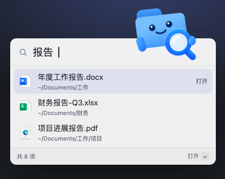

# macEverything

<p align="center">
  
</p>

[](https://github.com/modouai/macEverything/releases/latest)
[](https://github.com/modouai/macEverything/actions/workflows/ci.yml)
[](LICENSE)
[](#环境要求)
[](https://www.rust-lang.org/)

[English](README.md) | 简体中文

**macOS 文件名即时搜索——Windows [Everything](https://www.voidtools.com/zh-cn/support/everything/) 的 Mac 版。**

macEverything 自建索引、不走 Spotlight:Spotlight 静默搜不到的目录(隐私排除、`.noindex`、索引被关闭的位置),只要不在排除清单里就能搜到;权限缺口永远显式列出。

覆盖范围:用户主目录、`/Applications` 与本地外接磁盘(网络盘暂不索引)。

- **百万文件约 1 秒建好索引**:首扫 1M 文件 1.0-1.6 s,之后每次启动秒开(读落盘索引)
- **查询 P99 < 4 ms**:123 万+ 条目上的子串/通配搜索
- **实时增量**:文件系统变更 ≤ 0.3 s 可搜,空闲 CPU 0%
- **完整**:索引条目集与 `find` 零差异
- **悬浮条(⌥Space)**:跨全屏应用上方可唤起,输入即搜,键盘全操作
- **完整结果窗口(⌥⇧F)**:可排序、多选、原生右键菜单、Quick Look
- **目录助手(实验)**:其他应用弹出保存或打开面板时,旁边浮出目录搜索框,↵ 即让面板跳到该目录(默认关闭;需「设备控制和数据访问」权限)
- **双语界面**:简体中文 / English,默认跟随系统

## 悬浮条(⌥Space)

<p align="center">
  
</p>

在任意位置按 ⌥Space 唤起(全屏应用上方也可用),输入即搜。列表随输入更新(每次按键到结果中位约 67 ms);↑↓ 选择、↵ 打开、⌘↵ 在访达中显示、⌥↵ 带词进入完整结果窗口、Esc 隐藏。应用常驻菜单栏、无 Dock 图标,悬浮条不会遮挡整个屏幕。

## 为什么不走 Spotlight?

Spotlight 是出色的启动器,但它的索引由 macOS 管理,并且静默排除目录:TCC 保护目录、`.noindex`、主目录的某些部分。你永远不知道漏了什么。

macEverything 的做法:

| | Spotlight | macEverything |
|---|---|---|
| 收录哪些文件 | 由系统决定 | 用户主目录 + `/Applications` |
| 被 Spotlight 排除的目录 | 不收录 | 不在排除清单里就能收录 |
| 读不了权限的目录 | 不显示 | 逐目录列出名字与原因 |
| 开发目录 | 可能跳过 | 可搜索;`node_modules`、`.git` 默认排除 |
| 索引管理 | 由 macOS 管理 | 由应用管理 |
| 终端 | `mdfind` | `macEverything`(五个子命令,支持 `--json`) |

目录读不了(比如尚未授予完全磁盘访问权限)时,`status`、托盘菜单、结果窗口都会逐目录列出名字与原因——缺口从不静默。文件名搜索是 Everything 式子串/通配匹配 + 质量排序,而不是模糊的元数据搜索。

默认排除:`~/Library`、`node_modules`、`.git`、`~/.Trash` 以及各卷的元数据目录。可在「设置 → 索引」或 `macEverything exclude` 中修改。

<p align="center">
  
</p>

## 性能(Apple M5 + NVMe,约 123 万条目)

引擎口径:

| 指标 | 实测 | 说明 |
|---|---|---|
| 首扫 | 百万文件 **1.0-1.6 s** | 并行遍历;之后每次启动秒开(读落盘索引) |
| 查询 | **P99 2.9-3.6 ms** | 全索引子串/通配匹配 |
| 增量 | **≤ 0.3 s** 可搜 | FSEvents 实时;空闲 CPU 0% |
| 完整性 | 与 `find` **零差异** | 相同扫描根与排除规则下;由对拍测试保证 |
| 停机补齐 | 秒级 | 重启重放关机期间事件,非全量重扫 |

图形界面口径(release 构建):

| 指标 | 实测 | 说明 |
|---|---|---|
| 悬浮条唤起 | 中位 **95 ms** | ⌥Space 按下到可见(其中系统热键投递约 51 ms) |
| 输入到结果 | 中位 **~67 ms** | 逐字符,边输边出 |
| 常驻内存 | **~136 MB** | eframe/egui + OpenGL 技术栈基线,与窗口使用无关 |
| 隐藏态 CPU | **0%** | 两窗皆隐 |
| 新文件 → 界面可搜 | **267 ms** | 端到端 |

## 安装

### 下载(推荐)

官网下载 DMG(Developer ID 签名并通过公证),拖入「应用程序」即可:

**[maceverything.modouai.dev](https://maceverything.modouai.dev/)**

### 源码构建

环境要求:macOS 13+(Apple Silicon,不支持 Intel,发布的 DMG 仅含 arm64)、Rust stable。

```bash
git clone https://github.com/modouai/macEverything.git
cd macEverything

# 图形界面:构建 + 组装 .app + ad-hoc 签名 → release/macEverything.app
bash scripts/bundle.sh
open release/macEverything.app

# 仅命令行(软链进 PATH 中的任意目录):
cargo build --release
ln -sf "$PWD/target/release/macEverything" ~/.cargo/bin/macEverything
```

## 快速开始

启动后 App 常驻菜单栏(无窗口、无 Dock 图标,这是正常形态):

| 操作 | 方式 |
|---|---|
| 悬浮搜索条 | **⌥Space**:输入即搜,↑↓ 选择,↵ 打开,⌘↵ 访达显示,⌥↵ 带词进完整窗口,Esc 隐藏 |
| 完整结果窗口 | **⌥⇧F**:四列(名称/大小/修改时间/路径),点列头排序,多选,空格 Quick Look |
| 目录助手 | 保存/打开对话框旁的目录搜索框;设置 → 实验 →「目录助手」开启(默认关闭) |
| 菜单栏图标 | 左键切换悬浮条;右键:引擎状态、权限缺口、打开搜索/完整窗口、开机自启、设置、检查更新、退出 |

两个快捷键都能在 设置 → 通用 →「快捷键」中重新录制;被其他应用占用时自动降级到 ⌥⇧Space / ⌃⌥⇧Space,并在悬浮条内提示。

命令行:

```bash
macEverything start              # 引擎后台启动
macEverything query "报告"        # 即输即出
macEverything query "*.pdf path:Documents 2026"
macEverything query --sort mtime --desc "发票"   # 最新在前
macEverything status             # 索引状态 + 权限缺口
macEverything exclude add ~/Videos
macEverything exclude list       # add | remove | list | reset
macEverything stop
```

引擎离线时 `query` 自动降级:直读落盘索引,结果标注「离线索引 · 生成于 …」。

`query` 与 `status` 支持 `--json` 机器可读输出(带 schema_version),可供脚本与 AI/agent 工具直接调用;参数与 JSON 契约见[使用指南](docs/usage.md)。装了 App 的用户也可在设置 → 通用 →「命令行工具」一键把命令行安装到 PATH。

## 搜索语法

| 语法 | 语义 | 示例 |
|---|---|---|
| 关键词 | 文件名包含该子串;空格分隔 = 全部命中(AND) | `季度 报告` |
| `*` | 通配任意长度字符(含空) | `*.pdf`、`报告*` |
| `?` | 通配单个字符 | `报告?` |
| `path:` | 仅紧跟其后的一个词匹配完整路径 | `path:Documents 发票` |
| `case:` | 本轮区分大小写 | `case:README` |
| `whole:` | 本轮整词匹配 | `whole:init` |

<details>
<summary><b>完整语法规则与排序</b></summary>

- 默认大小写不敏感覆盖整个 Unicode(`café` 能搜到 `CAFÉ`),NFC/NFD 两种归一形态互搜。
- `path:` 只作用于紧跟其后的一个词;其余词仍匹配文件名。
- 语法前缀须小写;`*`/`?` 在词中就是通配符(没有转义)。
- 整词边界:`_` 与字母数字同属词字符——`whole:init` 命中 `init.rs`,不命中 `__init__.py`。
- 排序:`.app` 应用包整体置顶(嵌套在其它 bundle 内的 `.app` 除外);组内按文件名前缀命中 > 词边界命中 > 子串命中,同级名更短优先;列头排序不受影响。
- 组合示例:`path:项目 *.md`、`path:Documents 发票 2026`。
- 暂不支持:正则、`size:` 与日期过滤(v2 候选)。

完整规则见[使用指南](docs/usage.md)。

</details>

## 工作原理

FSEvents 事件只是提示:daemon 收到后重读该目录、与索引 diff,始终以磁盘为准。FSEvents 的 coarse semantics(dropped events、coalescing、one-sided renames)因此不会使索引偏离磁盘。

```
┌────────────────────────────────────────────┐
│ app · eframe/egui                          │
│ floating bar · results window · tray       │
│ hotkeys · autostart · update check         │
└──────────────────┬─────────────────────────┘
                   │ Unix socket · length-prefixed JSON
                   │ crates/protocol + crates/client
┌──────────────────▼─────────────────────────┐
│ cli · macEverything start (daemon)         │
│ ┌────────────────────────────────────────┐ │
│ │ engine · pure logic library            │ │
│ │ scan → index → query                   │ │
│ │ FSEvents → diff → index                │ │
│ │ mmap persistence (layout mirror)       │ │
│ └────────────────────────────────────────┘ │
└────────────────────────────────────────────┘
```

| crate | 职责 |
|---|---|
| `engine` | 全部业务逻辑:扫描、索引、查询、mmap 落盘、FSEvents 与目录 diff |
| `protocol` | 协议契约:消息、编解码、校验、版本 |
| `client` | 连接、按需 `stat`、离线降级、状态常量 |
| `cli` | daemon 宿主 + `start/stop/query/status/exclude`(支持 `--json`) |
| `app` | GUI:悬浮条、结果窗口、托盘、热键、开机自启、检查更新、目录助手 |

## 开发者

### 核心引擎

| 模块 | 设计 |
|---|---|
| 索引布局 | 扁平 `Entry` 数组(24 B/条)+ 双名称池 + 目录路径池;删除用墓碑位 |
| 查询 | 语法编译为锚定子串序列,每个 needle 预编译为 `memchr` Finder——123 万条目 P99 3.6 ms |
| 扫描 | work-sharing 并行遍历;首扫、增量、补链共用同一排除判定 |
| 落盘 | 磁盘文件与内存布局同构,加载即 `mmap` + 转型,零反序列化;tmp + rename 原子替换 |
| FSEvents | 事件只当提示:重读目录、与索引 diff,始终以磁盘为准 |
| 停机追平 | 落盘记录 `last_event_id`,重启重放停机窗口事件(秒级);保守兜底全量重扫 |

### 测试

三层;单元与对拍由 `cargo test --workspace` 运行,实机层标注 `#[ignore]`:

| 层 | 位置 | 验证内容 |
|---|---|---|
| 单元 | 各模块 `#[cfg(test)]` | 解析、匹配、索引操作、落盘、diff 逻辑;`tempfile` 受控目录树 |
| 对拍 | `crates/engine/tests/parity.rs` | 索引条目集 vs 独立递归枚举——零差异;串行与并行路径一致 |
| 实机 | `crates/engine/tests/fsevents_live.rs` | 真实 FSEvents 建流、收事件与停机重放;`#[ignore]`,实机手动运行 |

新增测试须做突变验证(临时改坏实现,确认测试变红)防止「恒绿假钉」,见 [CONTRIBUTING.md](CONTRIBUTING.md)。

### 仓库结构

```
crates/
├── engine/    扫描 · 索引 · 查询 · mmap 落盘 · FSEvents + diff
├── protocol/  协议契约(消息、编解码、校验、版本)
├── client/    连接 · 按需 stat · 离线降级
├── cli/       daemon + start/stop/query/status/exclude(支持 --json)
└── app/       eframe/egui 界面 · 托盘 · 热键 · 开机自启 · 检查更新
docs/          架构 · 使用 · 开发 · 规格
scripts/       打包 · 发布 · 基准 · 对拍 · 内存观测
```

## 已知限制

- 扫描范围:用户主目录 + `/Applications` + 本地外接磁盘(插入即自动索引,拔出即清除,可在设置按卷关闭);网络盘 SMB/NFS 暂不支持
- 默认排除:`~/Library`、`node_modules`、`.git`、`~/.Trash` 及各卷元数据目录(`.fseventsd`/`.Trashes`/`.Spotlight-V100`/`.DocumentRevisions-V100`);可通过 `macEverything exclude` 或设置 →「索引」调整
- `case:` 只作用于文件名侧(路径匹配恒不区分大小写)
- 暂无正则与 `size:`/日期过滤器(v2 候选)
- 界面进程空闲常驻约 136 MB,eframe/egui + OpenGL 技术栈基线,与窗口使用无关;超出 <100 MB 设计目标,详见[架构总览](docs/architecture.md)
- 悬浮条被其他窗口完全遮挡时,输入到结果退化到 ~500 ms(遮挡视口跳过渲染帧;悬浮条可见时不受影响)
- 引擎离线时完整窗口列排序不可用:状态栏提示并提供「重启引擎」按钮
- 目录助手为实验功能,默认关闭;需「设备控制和数据访问」权限,且无法作用于自绘保存/打开面板的应用(部分网页应用与 Electron 应用)

## 文档

| 文档 | 内容 |
|---|---|
| [使用指南](docs/usage.md) | 图形界面与五命令详解、语法规则、权限、数据目录、排障 |
| [架构总览](docs/architecture.md) | 引擎架构、核心设计决策与 ADR-7/8、生命周期、性能 |
| [开发指南](docs/development.md) | 构建/测试/基准、实机冒烟、约定与踩坑 |
| [规格档案](docs/specs/) | 各特性产品/技术/实现规格 |
| [官网指南](https://maceverything.modouai.dev/) | Mac 版 Everything、Spotlight 排障、Mac 文件搜索指南 |

## 参与贡献

欢迎 Issue 与 PR!

改动合并前,以下三项检查必须全部通过:

```bash
cargo fmt --check
cargo clippy --workspace --all-targets -- -D warnings
cargo test --workspace
```

完整开发流程见[开发指南](docs/development.md)。FSEvents 实机集成测试标注 `#[ignore]`,仅在真实 Mac 上运行:`cargo test -p engine --test fsevents_live -- --ignored`。

参与方式见 [CONTRIBUTING.md](CONTRIBUTING.md);漏洞报告见 [SECURITY.md](SECURITY.md);数据处理说明见 [PRIVACY.md](PRIVACY.md);第三方许可见 [THIRD-PARTY-NOTICES.md](THIRD-PARTY-NOTICES.md)。

## 环境要求

macOS 13+(Apple Silicon,不支持 Intel,发布的 DMG 仅含 arm64);源码构建需 Rust stable。数据目录 `~/Library/Application Support/macEverything/`。「完全磁盘访问权限」可选授予;不授予时未覆盖目录会显式列出,其余功能不受影响。索引文件约每 100 万个文件占 63 MB。可选的「目录助手」另行需要「设备控制和数据访问」权限。

## 许可证

[MIT](LICENSE) © modouai
