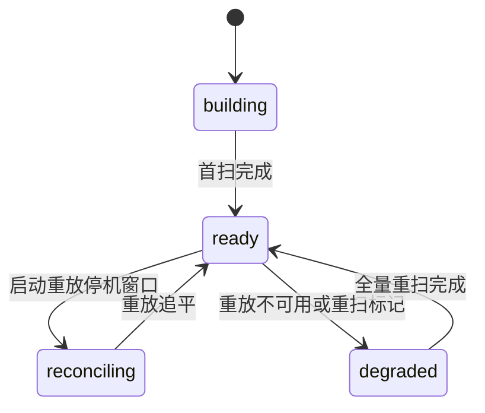

# macEverything v1-core 产品规格

**Status:** 产品已确认
**version:** 1.2.0
**prev_version:** 1.1.0
**updated:** 2026-10-15
**changes:**
- v1 范围收缩为纯引擎 + 命令行交互面;图形界面(悬浮条/完整窗口/设置/菜单栏/i18n)整体移入 v2 非目标;验收改为快/准/全三轴(1.1.0)
- 停机窗口事件重放(对标 Everything 的 USN 日志)进 v1;全量重扫降为唯一兜底(1.2.0)
- 首扫并行遍历:目标从 ≤ 20 秒收紧为 ≤ 5 秒,预期 1-3 秒,与 Everything 直读 NTFS MFT 同档(1.2.0)

---

## 概述

macEverything 是 macOS 上的全盘文件名即时搜索引擎,对标 Windows 下的 Everything(https://www.voidtools.com/zh-cn/support/everything/):自建全盘索引、即输即出、常驻轻量。**v1 只做引擎,不做图形界面**;引擎的验收只有三个字——快、准、全。交互面为命令行(常驻引擎进程 + 查询命令),图形界面是 v2 在引擎之上加的壳。

### 需求要点

- 自建全盘文件名索引(不走系统 Spotlight 索引),扫描根 = 用户主目录 + /Applications,排除目录可配置
- 快:百万文件规模,建索引 ≤ 5 秒(并行遍历)、查询 P99 < 10 毫秒、冷启动 < 1 秒、增量可查 ≤ 500 毫秒、空闲 CPU 0%
- 准:索引条目与文件系统对拍零差异;权限缺口显式计数,禁止静默遗漏
- 全:扫描根内所有可读目录 100% 递归覆盖;语法六项语义与 Everything 对齐
- 索引落盘:重启秒开;停机窗口由系统事件日志重放补齐(对标 Everything 的 USN 日志),全量重扫仅兜底
- 形态:常驻引擎进程(daemon,扫描 + 增量 + 落盘)+ 查询命令(连 daemon 实时查;daemon 不在时离线查落盘索引)

## 问题

1. macOS 自带 Spotlight 搜索慢且结果不全,存在「Finder 里看得到的文件,Spotlight 搜不到」的日常现象。证据:辉哥日常使用反馈(2026-10-15)——大目录检索明显卡顿;Finder 可见的文件因 Spotlight 隐私排除、索引禁用、`.noindex`/开发目录黑名单、索引损坏或滞后而搜不到;索引更新滞后于文件变化。
2. 市面 macOS 同类工具两极分化:走 Spotlight 索引的工具(含 Alfred 等启动器的文件搜索,底层同为 Spotlight)继承其黑名单与滞后——Spotlight 搜不到的它们同样搜不到;现场遍历磁盘的工具每次全盘扫描(太慢)。无一款达到 Windows Everything 的「即输即出 + 全盘 + 实时」体验。
3. 从 Windows 迁移到 mac 的用户(目标用户即辉哥本人)缺少 Everything 级别的文件定位工具,影响日常工作流。

## 目标

每条均可度量,验收阶段逐条复测。

**快**

1. 100 万文件全盘首扫 ≤ 5 秒(Apple Silicon 基准;多线程并行遍历,参考主流遍历工具实测预期 1-3 秒,与 Everything 直读 NTFS 主文件表同档。预算推导与基线锁定方式见技术规格;若实测推不出红线,本目标回辉哥重谈)。
2. 引擎查询 P99 < 10 毫秒(百万文件、任意子串)。
3. 冷启动(有落盘索引)到可查询 < 1 秒。
4. 文件系统变更到可被搜到 ≤ 500 毫秒(含事件合并等待)。
5. 索引落盘在独立线程执行,查询延迟不受落盘影响。
6. 空闲 CPU 占用 0%(纯事件驱动,无定时轮询);常驻内存 ≤ 500 MB(百万文件规模)。

**准**

7. 对拍零差异:同扫描根、同排除、同符号链接策略下,索引条目集与 `find` 遍历结果集完全一致。
8. 语法六项(关键词 AND、`*`、`?`、`path:`、`case:`、`whole:`)语义与 Everything 对齐,逐项通过用例。
9. 中文、emoji 等非 ASCII 文件名可搜;归一化形态不同的同一文件名可被同一关键词命中。

**全**

10. 扫描根内所有可读目录 100% 递归覆盖;权限不足目录显式计数,禁止静默遗漏。
11. 全程不读系统 Spotlight 数据,系统索引开关状态不影响本引擎。
12. 实时性覆盖:引擎运行期间文件系统的增删改均进入索引(事件合并标记触发时自动全量重扫兜底)。

## 非目标

| 不做 | 理由 |
|---|---|
| 图形界面:悬浮条、完整结果窗口、设置窗口、菜单栏 | **v2 做**;v1 专注引擎,交互面用命令行,避免 UI 工作稀释引擎验收 |
| 界面 i18n | **v2 做**;随图形界面一起,引擎层无界面文案 |
| 全局快捷键、多屏定位、深浅色 | **v2 做**;均属图形界面范畴 |
| 文件内容搜索(content:) | 非文件名搜索工具本职,引擎复杂度量级不同 |
| 正则搜索、大小/日期过滤器(size:/dm: 等) | 二期;v1 语法保持最小子集,先站稳核心体验 |
| 外置盘 / 网络盘扫描 | v1 扫描根固定内建盘;外置盘挂载语义独立成二期需求 |
| Windows / Linux 版本 | 架构不预设跨平台,但不承诺;先做透 macOS |
| 对外发布(签名公证、官网分发) | 个人使用,ad-hoc 签名跑本地 |
| HTTP 服务器 / ETP 接口 | 单机人用,过度设计 |

## 审核确认项

- [x] 目标机 = 辉哥的 mac(Apple Silicon,macOS ≥ 13);个人使用,ad-hoc 签名
- [x] **v1 = 纯引擎 + 命令行;图形界面与 i18n 整体后移 v2**(辉哥 2026-10-15 定)
- [x] 「完全磁盘访问权限」由命令行文本引导授予;未授权期间引擎照常运行,权限缺口如实计数
- [x] 索引落盘,内存映射加载秒开,启动后重放补齐停机窗口
- [x] 引擎常驻形态:daemon 进程常驻(扫描/增量/落盘),查询命令与 daemon 通信;daemon 未运行时查询命令离线查落盘索引
- [x] 独立 git 仓,v1 仅本地,不推远端
- [x] 依赖 rustup stable 工具链

## 功能描述

### 1. 全盘扫描与索引构建

**业务规则**

- 扫描根固定两项:用户主目录(`/Users/<当前用户>`)、系统应用目录(`/Applications`)。系统目录(如 /System、/private)不在扫描范围。
- 默认排除列表:用户库目录(`~/Library`)、`node_modules`、`.git`。用户可在配置中增删排除目录;排除目录整棵子树不入索引、不产生结果。
- 首扫采用多线程并行遍历(按子树分派、工作窃取调度),以打平 Everything 直读 NTFS 主文件表的首扫速度。
- 扫描只采集文件名与目录归属关系;文件大小、修改时间不随首扫采集,待查询结果按需读取(保证首扫速度)。
- 符号链接不入索引(防循环);权限不足的目录跳过并计数,不中断扫描。
- 权限缺口计数含缺口目录清单,可随时查看(见 §5 状态命令)。

**状态流转**(状态契约四态,全篇唯一):

| 状态 | 语义 | 进入条件 | 退出条件 |
|---|---|---|---|
| 构建中(building) | 首扫进行中,索引逐步填充 | 无可用落盘索引时的启动;索引损坏弃用重建 | 首扫完成 → 就绪 |
| 就绪(ready) | 稳态,增量管线健康 | 构建/补齐/重扫完成 | 触发补齐或重扫 |
| 补齐中(reconciling) | 计划内补齐进行中(停机窗口事件重放),成本 O(停机变更) | 启动加载落盘索引后开始重放 | 重放追平 → 就绪 |
| 重扫中(degraded) | 兜底全量重扫进行中,成本 O(全盘) | 重放不可用(零事件且长停机、日志滚动、重放失败)、系统重扫标记、监听器失效 | 全量重扫完成 → 就绪 |

构建中、补齐中、重扫中均可查询,结果可能不完整;状态命令可见进度(已索引 N 万文件)。

### 2. 实时增量维护

**业务规则**

- 监听 macOS 系统级文件变更事件(FSEvents),监听根与扫描根一致。事件仅当信号使用,不信任单条事件的语义细节。
- 收到事件后按 100 毫秒窗口合并,对受影响目录重新读取并比对索引,应用差异(新增/删除/改名)。目录改名对其整棵子树的路径归属级联更新。
- **停机窗口补齐(对标 Everything 的 USN 日志)**:macOS 系统事件日志支持从指定历史位置重放;daemon 每次落盘记录当时的日志位置,重启后从该位置重放停机期间的事件并应用,补齐在秒级完成,无需全量重扫。
- 全量重扫为唯一兜底:仅当重放不可用(零事件且长停机、系统事件日志已滚动丢弃历史、重放失败)或收到系统重扫标记、监听器失效时触发;触发后状态进「重扫中(degraded)」,状态命令可见。
- 空闲时零后台活动:无定时轮询,只有事件到达才工作。

### 3. 索引落盘与冷启动

**业务规则**

- 索引持久化到用户应用数据目录(`~/Library/Application Support/macEverything/`),文件为自定义紧凑二进制格式,含格式版本号字段。
- 启动时以内存映射方式加载索引文件,零反序列化直接可查,冷启动 < 1 秒。
- 落盘索引可能错过停机期间的变更:daemon 启动加载后立即从上次日志位置重放停机期间事件补齐(秒级),补齐期间状态为「补齐中」,旧索引照常可用。重放不可用时进「重扫中」,执行全量重扫。
- **保守防线**:「日志已滚动」可能无可靠的系统信号(实现前以 spike 验证);若重放零事件且停机时长超过保守阈值(默认 48 小时,可配置),无论有无信号一律转入全量重扫——杜绝静默遗漏。
- 落盘时机:增量变更攒批节流(距上次落盘 ≥ 30 秒或累计 ≥ 1 万条变更)+ daemon 退出时必写。落盘在独立线程执行,不阻塞查询。
- 索引文件损坏或版本不识别时弃用重建,全程不中断服务(期间按构建中状态)。

### 4. 搜索语法(产品契约)

v1 语法最小子集,与 Everything 语义对齐:

| 语法 | 语义 | 示例 |
|---|---|---|
| 关键词 | 文件名包含该子串;多个关键词以空格分隔 = 全部命中(且) | `季度 报告` |
| `*` | 通配任意长度字符(含空) | `*.pdf` |
| `?` | 通配单个字符 | `报告?` |
| `path:` | 仅作用于紧跟其后的一个关键词:该词匹配完整路径而非仅文件名;其余词仍匹配文件名 | `path:合同 2026` |
| `case:` | 本轮搜索区分大小写(默认不区分) | `case:README` |
| `whole:` | 本轮搜索整词匹配(默认子串) | `whole:init` |

- 默认大小写不敏感,覆盖整个 Unicode 范围(é/É 等非 ASCII 字母同样互搜),与 macOS 文件系统默认行为一致。
- 匹配排序:文件名前缀命中 > 词边界命中 > 子串命中;同级按文件名长度升序。
- 文件名匹配前按 Unicode 标准归一化(macOS 同一文件名存在两种归一形态,不归一会「搜不到看得到的文件」)。

### 5. 命令行交互面(v1 唯一交互面)

引擎以「常驻 daemon + 查询命令」两件套交付:

| 命令 | 作用 | 输出 |
|---|---|---|
| `macEverything start` | 启动常驻引擎(扫描、增量监听、落盘) | 后台运行;首扫进度与完成状态可查 |
| `macEverything stop` | 停止引擎,落盘后退出 | 停止确认 |
| `macEverything query "关键词"` | 查询;连 daemon 查实时索引,连不上则离线查落盘索引 | 结果列表(名称、路径、大小、修改时间)、命中总数、引擎耗时;上限 1000 条,超出提示 |
| `macEverything status` | 查看索引状态 | 状态(构建中/就绪/补齐中/重扫中)、已索引条目数、权限缺口计数与目录清单、IO 错误计数、索引文件位置与生成时间 |
| `macEverything exclude add/remove/list` | 管理排除目录 | 操作确认与当前列表;变更通知 daemon 重扫受影响范围 |

- 查询契约:输入 = 原始搜索串(含语法);输出 = 结果条目数组(名称、完整路径、大小字节、修改时间)、命中总数、引擎耗时(毫秒)。上限单轮 1000 条,超出提示「仅展示前 1000 条」。耗时口径:「引擎耗时」仅指索引匹配与排序;结果行的大小/修改时间为按需读取,并行执行、单独计时随输出给出,不计入引擎耗时——查询速度 P99 指标按此口径测量。
- 索引状态契约:状态四态(构建中/就绪/补齐中/重扫中)+ 已索引条目数 + 权限缺口计数与清单 + IO 错误计数。`status` 命令与未来 v2 图形界面消费同一状态源,输出格式即该契约的可读呈现。

### 6. daemon 生命周期

- `start` 后 daemon 常驻后台;重复 `start` 提示已在运行,不启动第二份(单实例)。
- `stop` 时完成最终落盘再退出;异常退出(崩溃、断电)不损坏既有索引文件(落盘原子替换:写临时文件成功后替换)。
- 登录自启属图形界面范畴,v2 处理;v1 手动 `start`。

## 数据结构设计

本项目无数据库,持久化为两类用户数据文件(数据契约,格式变更必走版本化迁移):

**索引文件**(应用数据目录下,单文件)

| 字段 | 类型 | 语义 |
|---|---|---|
| format_version | 整数 | 索引格式版本号,当前 1;程序不识别的版本弃用重建 |
| scan_roots | 路径列表 | 本次索引的扫描根 |
| entries | 条目数组 | 每条 = 文件名 + 父目录编号(目录名经父指针共享,不重复存储) |
| entry_count | 整数 | 条目总数(status 与未来界面状态栏展示) |
| excluded | 目录列表 | 生成索引时的排除列表快照 |
| built_at | 时间戳 | 索引生成时间(排障展示) |
| last_event_id | 整数 | 落盘时的系统事件日志位置;重启后从此位置重放停机期间事件 |

**配置文件**(应用数据目录下,单文件):排除目录列表。配置变更即时生效并回写。

**数据兼容承诺**:上述两类文件是用户数据契约;结构变更必走版本化迁移,禁止静默改格式;旧文件必须能被新版本读取或显式迁移。

## 场景推演

**场景 1:冷启动秒开 + 停机变更补齐**
假设:昨日 `stop` 时索引已落盘,期间用户在 Finder 新建了 3 个文件;今日 `start`。
- 启动 → 1 秒内加载落盘索引,`query` 立即可查旧数据
- 同时 → 从上次日志位置重放停机期间事件,3 个新文件秒级进入索引;实时事件流接续工作
- 补齐完成 → 索引文件原子替换,状态回「就绪」(仅当重放不可用时才进「重扫中」执行全量重扫)

**场景 2:建索引期间搜索**
假设:首次 `start`,全盘扫描进行中(预计 1-3 秒,红线 ≤ 5 秒)。
- `query` → 已扫部分立即返回结果,`status` 显示「构建中 42 万」
- 扫描完成 → 后续查询覆盖全量,状态回「就绪」

**场景 3:权限缺口**
假设:「完全磁盘访问权限」未授予,用户库目录不可读。
- 首扫继续 → 可读区域正常入索引
- `status` → 权限缺口计数含缺口目录清单与授权引导文案
- 用户授权并重启扫描 → 缺口清零

**场景 4:批量解压(事件风暴)**
假设:解压产生 2 万个文件。
- 事件按 100 毫秒窗口合并 → 受影响目录批量重扫一次,而非 2 万次
- 索引更新与落盘节流生效 → 查询延迟始终在指标内

**场景 5:daemon 不在**
假设:重启电脑后未 `start`,直接 `query`。
- 查询命令 → 离线加载落盘索引返回结果(数据可能略旧),输出中标注「离线索引」与索引生成时间
- 引导文案 → 提示 `start` 获得实时结果

## 对现有功能影响的评估

全新独立项目,无既有功能、无存量用户数据,无影响。

## 边界情况

| 异常 | 行为 |
|---|---|
| 目录/文件无权限 | 跳过 + 权限缺口计数,不中断 |
| 索引文件损坏 / 版本不识别 | 弃用重建,期间按「构建中」可查 |
| 落盘失败(磁盘满) | `status` 提示落盘失败,内存索引照常工作,下次落盘重试 |
| daemon 崩溃 / 断电 | 已落盘索引完好(原子替换);重启 `start` 后重放补齐(必要时全量重扫) |
| 重复 start | 提示已在运行,单实例不重复启动 |
| 索引中目录被整体删除 | 事件触发该子树级联移除 |
| APFS 大小写敏感分区 | `case:` 语义照常,默认不区分大小写不受影响 |
| 中文/emoji 等非 ASCII 文件名 | 全程支持;匹配前归一化,两种归一形态可互搜 |
| 文件名超长 / 路径超长 | 照常入索引;查询输出完整路径 |
| 扫描根不存在(如重命名了主目录) | 启动校验报错并给可操作提示 |
| daemon 未运行时执行 `status` | 离线应答:读索引文件头返回状态快照,输出标注「离线」 |
| daemon 未运行时执行 `exclude` | 报错并提示先执行 `start`(排除变更需增量管线配合生效) |
| 手工编辑配置文件 | 不被运行中的 daemon 感知;`exclude` 命令是唯一运行时写口,手工改动重启后生效 |

## 验收标准

**快**

- [ ] 合成百万文件树首扫 ≤ 5 秒(Apple Silicon)
- [ ] 百万文件规模,任意子串查询引擎 P99 < 10 毫秒(口径:索引匹配与排序耗时,不含结果行按需读取)
- [ ] 有落盘索引时,`start` 到 query 可用 < 1 秒
- [ ] 文件系统变更(新建/改名/删除)到可被搜到 ≤ 500 毫秒
- [ ] 落盘期间并发查询延迟无劣化
- [ ] 空闲 10 分钟 CPU 占用 0%

**准**

- [ ] 对拍脚本:同扫描根、同排除、同符号链接策略下,索引条目集与 `find` 结果集差异为空
- [ ] 语法六项(关键词 AND、`*`、`?`、`path:`、`case:`、`whole:`)逐项用例通过
- [ ] 中文文件名、emoji 文件名可搜;两种 Unicode 归一形态互搜命中
- [ ] 排除目录内文件 0 命中

**全**

- [ ] 权限不足目录全部计入缺口,`status` 可见清单
- [ ] 场景 1~5 按推演逐一复现
- [ ] 停机期间变更由事件日志重放补齐,万级事件补齐 ≤ 2 秒,不随停机时长增长
- [ ] 重放不可用或零事件且停机超保守阈值时,自动转全量重扫,最终一致且状态可见
- [ ] 手动制造监听器失效,引擎自动转全量重扫并回「就绪」,期间无静默遗漏
- [ ] 系统 Spotlight 关闭状态下引擎功能完整
- [ ] 对照实验:在 Spotlight 搜不到的位置(Spotlight 隐私排除目录、`.noindex` 目录、Spotlight 未索引的内置卷)创建文件,本引擎可搜到——「看得到就能搜到」

## 测试与验证

- **引擎单测(TDD)**:语法解析、匹配器(大小写/整词/归一化)、索引增删改/目录级 diff/子树级联/路径池、落盘格式读写回环、原子替换、全量重扫差异应用——全部纯逻辑,先写失败测试再实现。
- **性能基准**:脚本合成 100 万文件树(临时目录,测后清理),跑建索引、查询、增量、落盘、停机重放五项基准,输出数字对照「目标」章节。
- **对拍完整性**:`find` 结果集与索引条目集自动比对。
- **daemon 实机验证**:`start` → 首扫 → 增删改文件验证 500 毫秒时效 → `stop` 落盘 → 停机期间改文件 → 重启冷启动秒开且重放补齐可查 → 崩溃恢复(杀进程后重放/重扫补齐)→ 离线查询(场景 5)。

## 待决策问题

- 🟡 **non-blocking**(实现期定,辉哥有偏好随时拍):合成基准树用真实项目目录还是纯合成(默认纯合成,可控可复现)。
- 🟡 **non-blocking**:Rust 工具链锁 stable 最新还是固定版本号(默认锁固定版本,保证构建可复现)。
- ✅ **已决**(技术规格 ADR-4):daemon 与查询命令经本机套接字通信,契约见技术规格。
